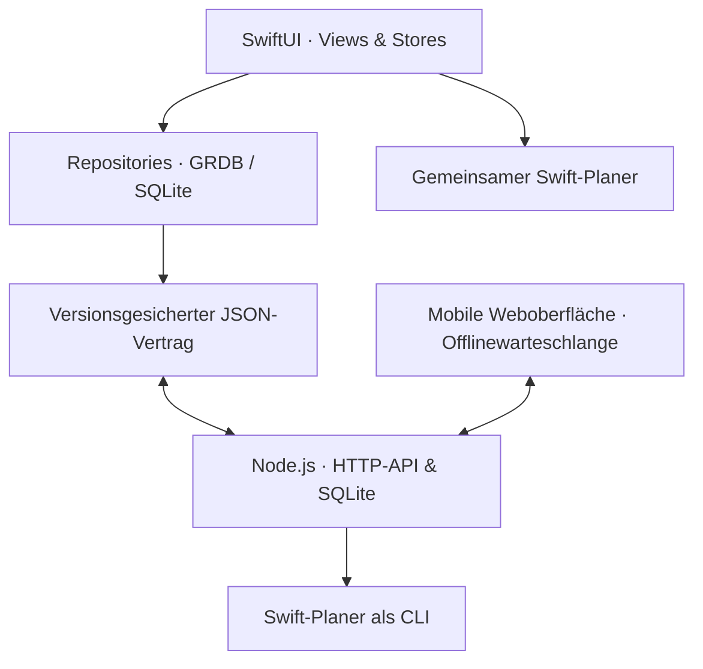

<p align="center">
  
</p>

<h1 align="center">AboLife</h1>
<p align="center">Ein persönlicher Alltagsbegleiter für macOS – mit adaptiver Lernplanung und privatem mobilen Webzugriff.</p>
<p align="center"><strong>Hauptversion 0.4.0</strong> · SwiftUI · SQLite/GRDB · Node.js · Docker</p>

AboLife verbindet Studienplanung, tägliche Gewohnheiten, Training und Budget in einer nativen Mac-App. Eine ergänzende Weboberfläche erlaubt Eingaben unterwegs. Das Projekt entstand aus dem Wunsch, diese Abläufe an einer Stelle zusammenzubringen, und dient als praktisches Softwareentwicklungsprojekt.


## Funktionen

| Bereich | Verhalten |
|---|---|
| Kalender & Lernen | ICS-Import, Serien und automatische Vor-/Nacharbeit für Uni-Module. Fahrtwege, freie Lerntage, Pausen, Tageslimits und fixierte Blöcke begrenzen die Planung. |
| Tagesübersicht | Daily Core, offene Tagespunkte, Gewohnheiten, Aktivitäten und eine kompakte Menüleiste. |
| Finanzen | Ausgaben, Monats-/Tagesbudget, Kategorien, Fixkosten und Sparziele. Heutige Ausgaben reduzieren den heutigen Spielraum um den vollen Betrag. |
| Training & Gewicht | Workout-Varianten, Übungen/Sätze, Gewichtseinträge, Statistiken und Wochenreview. |
| News | Privater RSS-/Atom-Reader mit Quellenwahl, Suche, Ausschlusswörtern und Merkliste. |
| Mac ↔ Web | Revisionsgesicherter Abgleich, Zusammenführung unabhängiger Änderungen und explizite echte Konflikte. |
| Unterwegs | Mobile Eingaben, Lernbewertungen, Trainingsplan und Wochenreview; lokale Warteschlange für Offlineeingaben. |
| Sicherungen | SQLite/JSON/CSV-Export und geprüfte Wiederherstellung mit Sicherung vor dem Ersetzen. |

Ernährung und Telegram wurden mit 0.3 aus dem aktiven Produkt entfernt. Historische Datenmodelle bleiben ausschließlich für lokale Migrationen und Sicherungen erhalten.

## Technischer Aufbau



- **Native App:** SwiftUI/AppKit, Stores und Repositories; persistierte Einträge bilden die Primärdaten. SQLite-Migrationen erhalten bestehende Daten.
- **Lernplanung:** Ein gemeinsamer Swift-Kern läuft im Mac und im Homelab-Container. Dadurch werden Termin-/Fahrtregeln nicht in zwei Sprachen separat implementiert.
- **Web:** Node-Standardbibliotheken einschließlich `node:sqlite`; keine npm-Laufzeitabhängigkeiten. Die Oberfläche verwendet HTML, CSS und JavaScript.
- **Synchronisierung:** Revisionsprüfung und Drei-Wege-Zusammenführung. Gleichzeitige widersprüchliche Änderungen bleiben sichtbar; Beziehungen und Tagesdatensätze werden geprüft.
- **Betrieb:** Docker mit dauerhaftem Volume, privatem HTTPS über Tailscale und konsistenten Online-Sicherungen. Zugangsdaten liegen auf dem Mac im Schlüsselbund.

Die [Architektur](docs/ARCHITECTURE.md), der [Datenvertrag](docs/DATA_MODEL.md) und die [Entscheidungen und Abwägungen](docs/PROJECT_OVERVIEW.md) erläutern die Details.

## Lokal starten

Voraussetzungen: macOS 14 oder neuer, Xcode mit Swift 6.1 oder neuer und Internetzugriff zum einmaligen Auflösen der gepinnten GRDB-Abhängigkeit. Node 24 wird für Web-/Vertragstests benötigt.

1. Repository klonen und `AboLife.xcodeproj` öffnen.
2. Swift-Package-Abhängigkeiten auflösen.
3. Schema **AboLife → My Mac** starten.

Die Mac-Kernfunktionen benötigen weder einen Account noch ein Serverpasswort. Die Haupt-App verwendet den stabilen Datenordner `AboLife-Main`. Beim ersten Start wird ein vorhandener Kalender-Preview-Stand kopiert, ersatzweise der alte 0.1-Stand. Die Quell-Datenbanken bleiben unverändert.

### Tests und Pakete

```sh
scripts/check-native.sh
scripts/package-local-app.sh
scripts/package-homelab.sh
```

`check-native.sh` nutzt einen vorhandenen GRDB-Checkout. Alternativ `ABOLIFE_GRDB_CHECKOUT` explizit setzen; siehe [CONTRIBUTING.md](CONTRIBUTING.md). Die Haupt-App entsteht unter `outputs/AboLife.app`, die ZIP unter `outputs/AboLife-0.4-macOS.zip`. Builddateien und persönliche Daten gehören nicht in Git.

### Präsentation mit Demodaten

```sh
scripts/package-demo-app.sh
```

Die daraus erzeugte `outputs/AboLife-Demo.app` besitzt eine eigene App-Kennung und legt ausschließlich fiktive Daten in einer temporären Datenbank an. Sie übernimmt keine persönlichen Daten. Die Screenshots in diesem README verwenden diesen Modus.

### Privater mobiler Zugriff

Die [Homelab-Anleitung](web/README.md) beschreibt Docker, Tailscale, HTTPS, Passwort und Geräteabgleich. Der Webserver ist eine selbst betriebene persönliche Anwendung; dieses Repository ist kein öffentlicher Demoserver.

## Prüfstand und Grenzen

Lokal bestehen **232 native Tests und 26 Web-/Clienttests**, einschließlich Swift↔JavaScript-Datenvertrag, gemeinsamem Planer, Konkurrenzkonflikten, Offline-Duplikatschutz und Wiederherstellung. Eine GitHub-Actions-Konfiguration prüft Weblogik, native Verträge und den Linux-Container. Konfigurierter CI-Umfang ist keine Behauptung über bereits erfolgreiche Remote-Läufe.

Der tatsächliche Homelab-/iPhone-Abgleich und mobile Safari-/Service-Worker-Lebenszyklen benötigen weiterhin die Abnahme auf den Zielgeräten. Individuelle Satzwerte und detaillierte Lernblockverschiebungen werden am Mac bearbeitet. Eine historische CSV-Sicherung ohne vollständigen Begleitstand kann nicht verlustfrei wiederhergestellt werden.

[TESTING.md](TESTING.md) trennt automatisierte Prüfungen von noch offenen Liveprüfungen. [TODO.md](TODO.md) und die [Roadmap](docs/ROADMAP.md) dokumentieren den aktuellen Umfang.

## Projekt und Rechte

**Arber Gjihollaj** · persönliches Entwicklungsprojekt für Studium, Alltag und Portfolio. Der Quellcode steht zur Einsicht und zum Code-Review bereit; die Rechte regelt [LICENSE](LICENSE). Drittanbieterbedingungen: [THIRD_PARTY.md](THIRD_PARTY.md). Hinweise zum sicheren Umgang mit Daten: [SECURITY.md](SECURITY.md).
