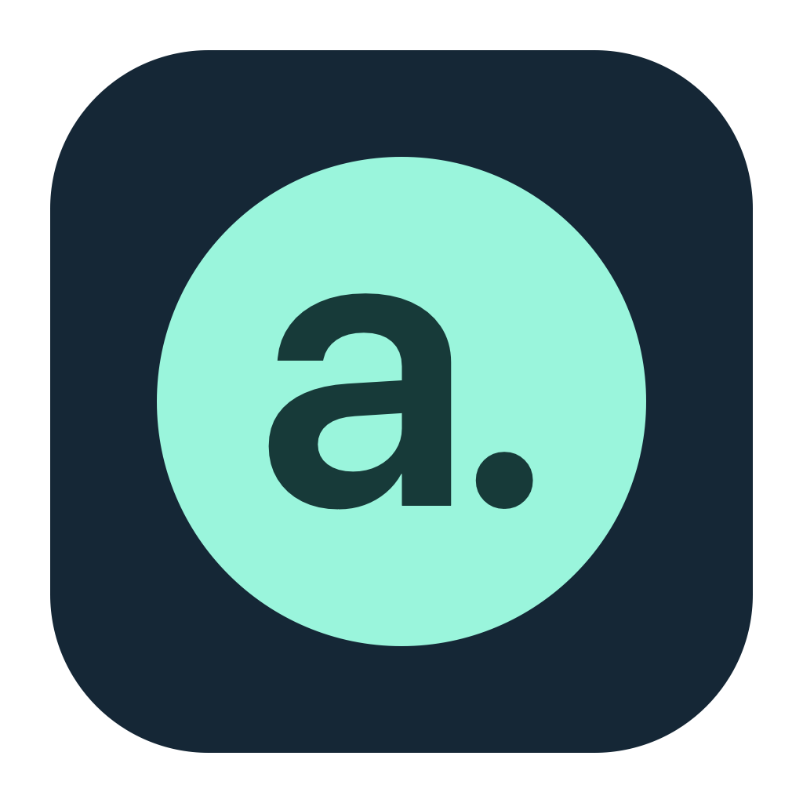
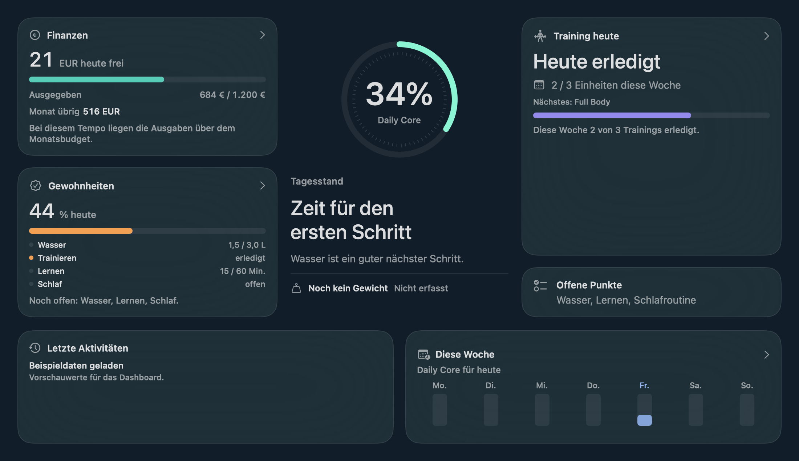
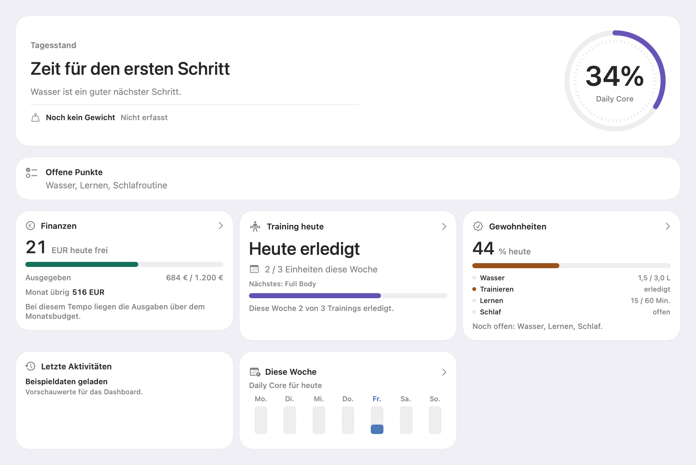
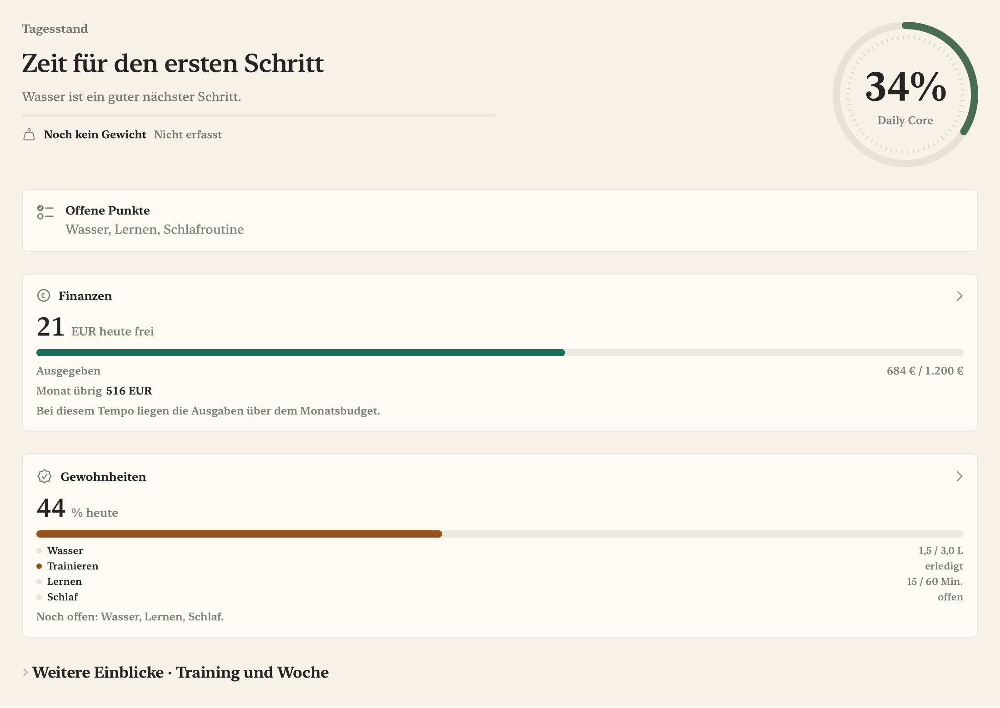

# AboLife



Ein persönlicher Alltagsbegleiter für macOS: Finanzen, Bewegung, Gewohnheiten, Kalender und Wochenreflexion an einem Ort. Lokale SQLite-Daten, optionaler privater Webabgleich und ein lokaler KI-Assistent über BonsaiBar.

**macOS 14+ · SwiftUI · GRDB/SQLite · Version 0.4.1**

## Eine App, drei Designs

Unter **Einstellungen → Dein Design** lässt sich die gesamte Oberfläche wechseln. Daten, Fachfunktionen und KI-Verbindung bleiben dieselben.

| Spatial | Bento | Fieldnotes |
|---|---|---|
| Räumlicher Tageskern, transparente Karten, Navigation im unteren Dock. | Kompakte Seitenleiste und umsortierbare Dashboard-Widgets. | Ruhiges Journal, warme Flächen, Serifenschrift und reduzierte Übersicht. |
|  |  |  |

Die Bilder sind automatisch gerenderte Ausschnitte der **echten nativen Dashboard-Views** mit ausdrücklich fiktiven Vorschauwerten. Sie zeigen keine persönlichen Daten und keine vollständigen Fensteraufnahmen. Die laufende Demo wurde zusätzlich manuell geprüft. [Alle 12 Ansichten und ihre Prüfmethode](docs/SCREENSHOTS.md).

Akzentfarben sind unabhängig vom Design einstellbar. Hell/Dunkel/System folgt der gewählten Darstellung. Im Bento-Modus lassen sich Widgets in den Einstellungen ziehen oder über beschriftete Pfeiltasten verschieben. Reduce Motion wird berücksichtigt.

## Funktionen

- **Heute:** Daily Core, offene Tagespunkte, Budget, Training, Gewohnheiten und direkte Schnellerfassung.
- **Finanzen:** Buchungen, Monatsbudget, Kategorien, Fixkosten und Planung. Tages- und Monatsbudget haben getrennte Bedeutungen.
- **Gesundheit:** Heimtrainingspläne mit Übungen/Sätzen, Wochenfortschritt und tatsächlich erfasste Gewichtsmessungen.
- **Gewohnheiten und Reflexion:** Wasser, Lernen und Schlafroutine; Training wird aus Einträgen abgeleitet. Wochenreview und Statistiken fassen gespeicherte Werte zusammen.
- **Kalender:** Termine, Serien, ICS-Import und die bestehende deterministische Modul-/Themenplanung mit Fahrtwegen und Pausen.
- **Nachrichten:** RSS-Quellen, Filter und Lese-/Merkstatus.
- **Mac und Web:** Optionaler revisionsgesicherter Abgleich mit einem privaten Homelab. Die mobile Weboberfläche ergänzt die Mac-App.
- **Sicherung:** SQLite-, JSON- und CSV-Export sowie geprüfte Wiederherstellung.

## Bestehende lokale KI

**AboLife AI** ist in jedem Design erreichbar. Der Zugang öffnet denselben vorhandenen Assistenten mit lokalem BonsaiBar-Connector, Chatverlauf, Kontextvorschau, ausdrücklichen Freigaben und prüfbaren Aktionsvorschlägen. Eine Antwort allein verändert keine Fachdatensätze; Änderungen werden separat bestätigt.

Die Demo lädt keine persönlichen Verbindungsdateien und ruft kein echtes Modell auf. BonsaiBar läuft getrennt von AboLife. Die geplanten weitergehenden Analytics-/Review-/News-Erweiterungen sind nicht Teil dieses Redesigns. [KI-Architektur](docs/AI_INTEGRATION.md).

## Lokal entwickeln

Xcode mit macOS-SDK, Swift 5 und Node.js 24+ verwenden. In Xcode `AboLife.xcodeproj` öffnen, Schema **AboLife** wählen und den festgelegten GRDB-Stand auflösen.

```sh
xcodebuild -resolvePackageDependencies -project AboLife.xcodeproj -scheme AboLife
scripts/check-quality.py
scripts/check-native.sh
scripts/package-local-app.sh
scripts/package-demo-app.sh
```

`check-native.sh` nutzt einen vorhandenen GRDB-Checkout; alternativ `ABOLIFE_GRDB_CHECKOUT` setzen. Keine andere aktive Codebasis in alten ZIPs oder Buildordnern verwenden.

Die Haupt-App entsteht unter `work/app-build.noindex/AboLife.app`, die aktuelle ZIP unter `outputs/AboLife-0.4.1-macOS.zip`. Für eine einzelne Installation die ZIP entpacken und `AboLife.app` im Programme-Ordner ersetzen. Interne Build-Bundles bleiben außerhalb von Spotlight.

### Isolierte Demo und Design Lab

`work/app-build.noindex/AboLife-Demo.app` verwendet eine eigene Bundlekennung und ausschließlich temporäre Beispieldaten. Persönliche Datenbank, Einstellungen, Sync und KI-Zugangsdaten sind getrennt.

Die ursprünglichen Entwürfe und der Bewertungsprozess bleiben als separates Entwicklerwerkzeug erhalten:

```sh
npm start --prefix design-lab
```

Danach `http://127.0.0.1:4177` öffnen. [Design Lab](design-lab/README.md). Persönliches Feedback gehört nicht ins Repository.

### Privater mobiler Zugriff

Der Webteil unter `web/` nutzt Node/SQLite und denselben Swift-Planer. Für den persönlichen Betrieb sind privates HTTPS, ein geschütztes Datenvolume und explizite Zugangsdaten notwendig. [Homelab-Anleitung](web/README.md). Es gibt keine öffentliche Beispieldatenbank und keine automatische Bereitstellung.

## Prüfstand des Redesigns

Native Tests, Webvertrag und Format-/Strukturprüfungen werden lokal ausgeführt. Der konkrete aktuelle Lauf, optionale Skips und die Einschränkungen von Xcode-/UI-Tests stehen im [Redesign-Bericht](docs/REDESIGN_REPORT.md). Die 19 Tests des separaten Design Labs prüfen dessen Prototypen und Feedbackspeicherung.

Die native Demo wurde mit allen drei Designs, dem Widgeteditor und dem vorhandenen KI-Dialog manuell angesehen. Die Renderbilder ersetzen keine vollständige Accessibility- oder Performanceabnahme. Ein älterer UI-Testlauf gilt nicht als Nachweis für die neue Oberfläche.

## Orientierung im Repository

| Pfad | Inhalt |
|---|---|
| `AboLife/` | Aktive macOS-App: App, Features, DesignSystem, Charts, Persistence, Sync |
| `AboLifeTests/`, `AboLifeUITests/` | Isolierte Fach-, Vertrags-, Render- und UI-Prüfungen |
| `AboLife.xcodeproj/` | Explizites Xcode-Projekt mit App-, Unit- und UI-Testtarget |
| `web/` | Privater Homelab-Server und mobile Weboberfläche |
| `design-lab/` | Separate Konzeptgalerie; kein Produktcode |
| `scripts/` | Prüfungen und lokale Paketierung |
| `docs/` | Architektur, Datenmodell, Designsystem, Entscheidungen und Bildgalerie |
| `docs/archive/`, `docs/design-assets/` | Historische Bildschirmaufnahmen und ursprüngliche Iconentwürfe |
| `work/`, `outputs/` | Ignorierte lokale Prüf-/Buildartefakte und aktuelle Ausgaben |

[Architektur](docs/ARCHITECTURE.md) · [Datenmodell](docs/DATA_MODEL.md) · [Designsystem](DESIGN.md) · [Tests](TESTING.md) · [Sicherheit](SECURITY.md) · [Mitwirken](CONTRIBUTING.md)

AboLife ist ein persönliches Entwicklungs- und Lernprojekt und wird mit KI-Unterstützung entwickelt. Es enthält keine Banking-, Mail- oder HealthKit-Anbindung. Ernährung und Telegram sind als Produktfunktionen entfernt; historische Tabellen bleiben für Backupkompatibilität erhalten.
