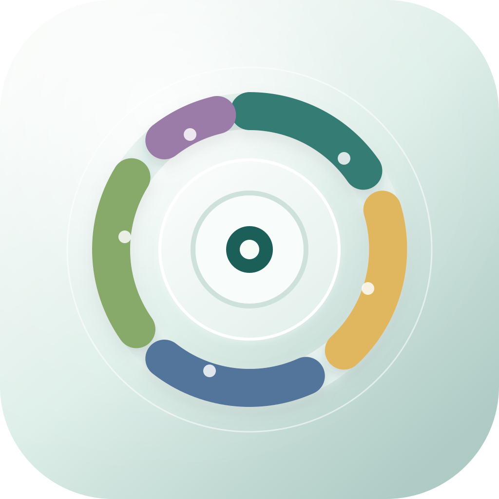
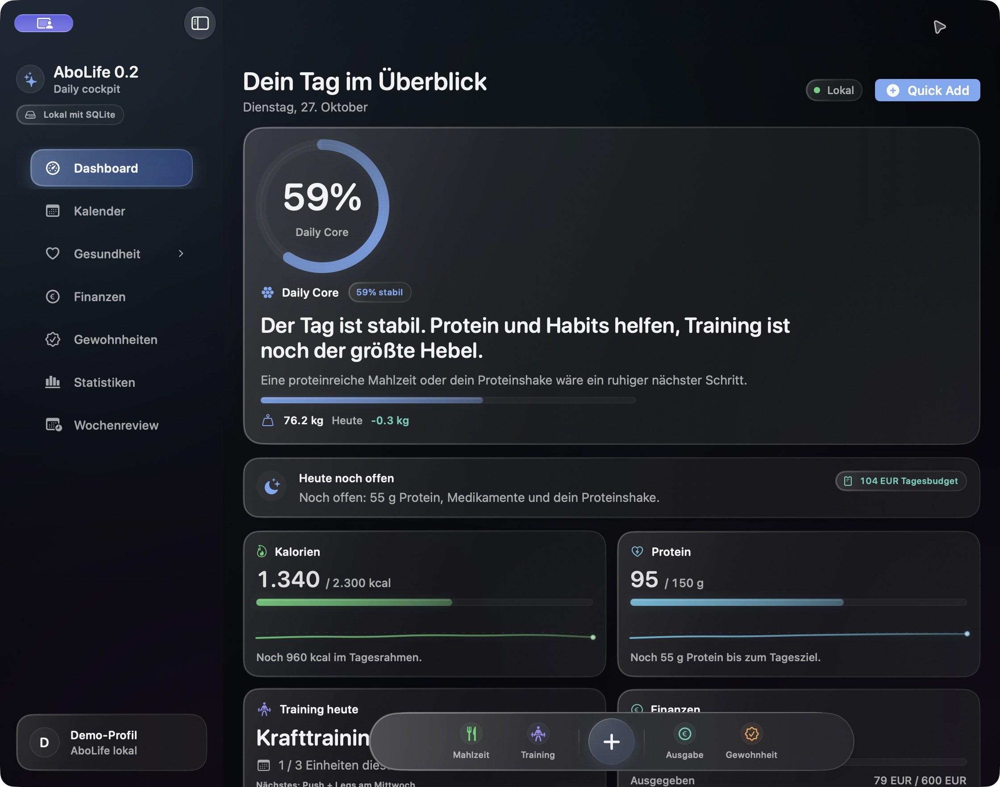
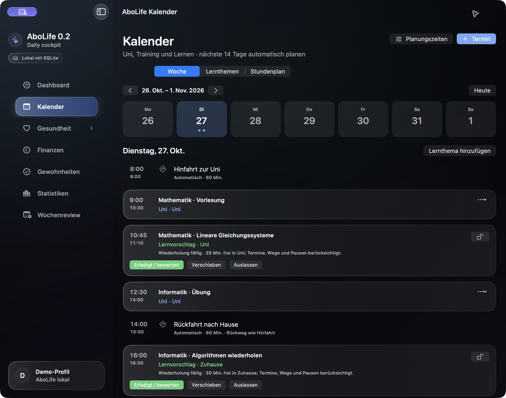
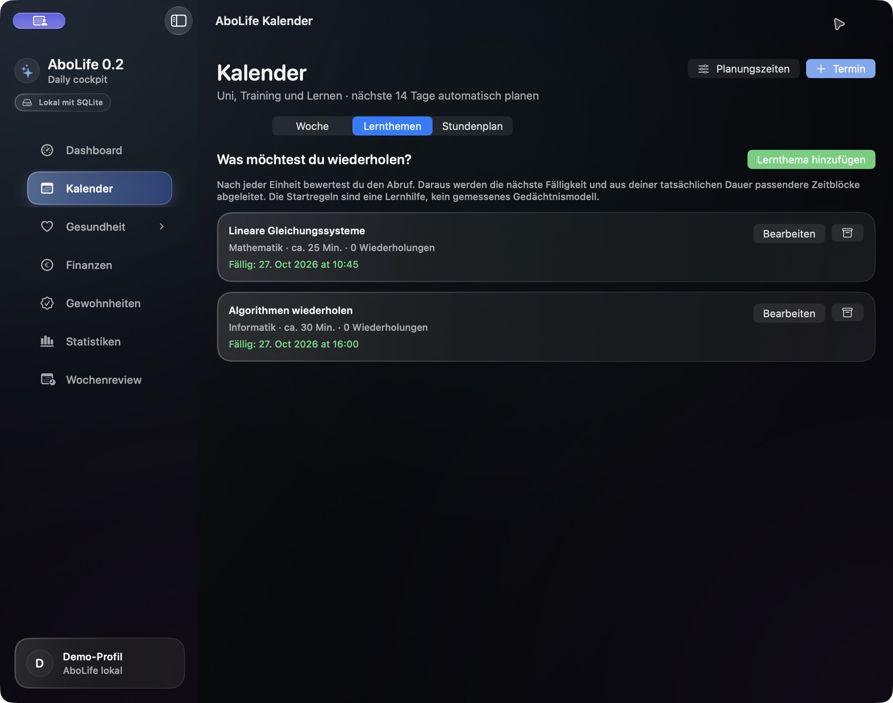
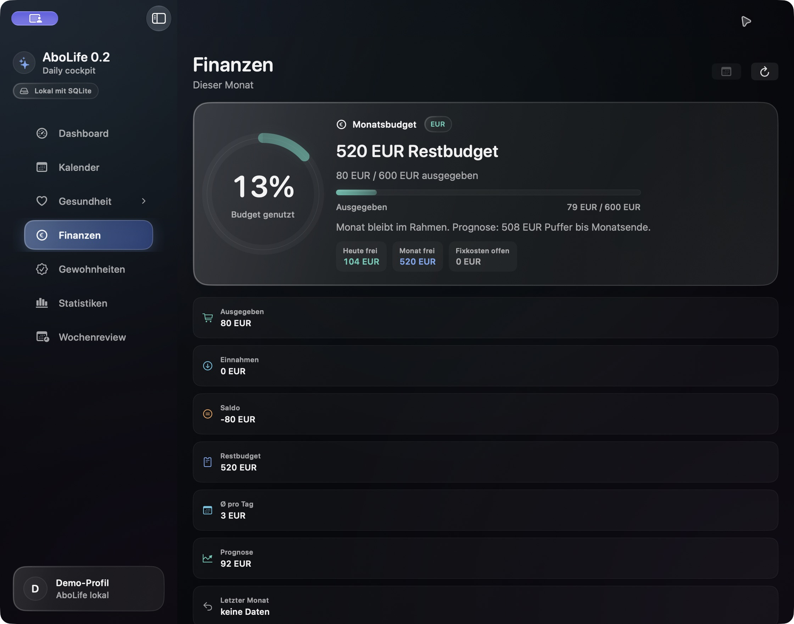

<div align="center">
  
  <h1>AboLife</h1>
  <p><strong>Dein Alltag. An einem Ort.</strong></p>
  <p>Ein persönliches macOS-Cockpit für Studium, Gesundheit, Finanzen und Gewohnheiten.</p>
  <p>
    
    
    
    
  </p>
  <p><a href="#die-idee">Die Idee</a> · <a href="#ein-blick-in-die-app">Screenshots</a> · <a href="#starten">Starten</a> · <a href="docs/CALENDAR_GUIDE.md">Kalender-Anleitung</a> · <a href="CHANGELOG.md">Änderungen</a></p>
</div>



## Die Idee

Ein voller Tag besteht aus vielen kleinen Entscheidungen: Wann passt eine Lerneinheit zwischen zwei Vorlesungen? Wie viel Budget ist heute noch frei? Was habe ich gegessen, wie regelmäßig trainiere ich und welche Gewohnheiten kommen zu kurz?

AboLife bringt diese Bereiche in eine gemeinsame Tagesübersicht. Die Idee ist aus dem eigenen Studienalltag entstanden: Planung soll die tatsächlichen Termine, Fahrtwege und verfügbaren Zeiten berücksichtigen. Kleine Eingaben sollen schnell gehen, während Fortschritte über Tage und Wochen nachvollziehbar bleiben.

Die App wird als persönliches Projekt entwickelt. Die aktuelle Kalender-Preview erweitert das bestehende Alltags-Cockpit um einen eigenen Stundenplan und eine lokale Lernplanung.

## Was AboLife verbindet

| Bereich | Was du damit machen kannst |
| --- | --- |
| **Tagesübersicht** | Ernährung, Training, Budget, Gewohnheiten und Wochenfortschritt gemeinsam überblicken. |
| **Kalender & Studium** | Termine manuell pflegen, Wochenserien anlegen und einen ICS-Stundenplan vor der Übernahme prüfen. |
| **Lernplanung** | Fällige Themen in freie Zeitfenster verteilen; Fahrtwege, Pausen, Tagesgrenzen und Prüfungsdaten einbeziehen. |
| **Gesundheit** | Mahlzeiten und Protein erfassen, Workouts dokumentieren sowie Gewicht und Verlauf verfolgen. |
| **Finanzen** | Einnahmen, Ausgaben, Budgets, wiederkehrende Posten und Sparziele verwalten. |
| **Gewohnheiten & Rückblick** | Messbare Gewohnheiten verfolgen und die Woche mit Erfolgen, Schwierigkeiten und einem nächsten Fokus abschließen. |
| **Menüleiste** | Tagesstatus und verfügbares Tagesbudget prüfen und Einträge über eine kompakte Schnellaktion hinzufügen. |

## Ein Blick in die App

Alle Screenshots zeigen die echte macOS-Oberfläche mit **frei erfundenen Beispieldaten**. Die Darstellung stammt aus einer getrennten Demo-Instanz; persönliche Termine, Gesundheits- und Finanzdaten wurden nicht veröffentlicht.

### Ein Kalender, der Wege mitdenkt

Uni-Termine bleiben während der Pausen ein zusammenhängender Aufenthalt. Nach dem letzten Uni-Termin geht es zunächst nach Hause; vor einem späteren Training wird die passende Hinfahrt von Zuhause reserviert. Zeitlich unmögliche Verbindungen und fehlende Wegedauern erscheinen als Hinweise.



### Wiederholen, bewerten, neu planen

Lernthemen haben eine Fälligkeit, eine geschätzte Dauer und optional einen Prüfungstermin. Nach einer Einheit beeinflussen **Vergessen**, **Schwer**, **Gut** oder **Leicht** den nächsten Abstand. Tatsächliche Lerndauern helfen bei der Schätzung weiterer Blöcke. Neue Termine lösen eine Neuplanung aus; fixierte Konflikte bleiben sichtbar.



Die Wiederholungsregel ist eine dokumentierte Heuristik für Themenblöcke. Sie ist kein trainiertes Gedächtnismodell und verspricht keinen optimalen Lernerfolg. Die Regeln und Grenzen stehen in der [Kalender-Anleitung](docs/CALENDAR_GUIDE.md).

### Finanzen im Alltag

Budgets und Ausgaben fließen in die Tagesplanung ein. Die App zeigt, welcher Betrag noch verfügbar ist, und unterstützt wiederkehrende Posten sowie Sparziele.



## Starten

### Voraussetzungen

- Ein Mac mit **macOS 14 oder neuer**; der Liquid-Glass-Hintergrund der Menüleistenansicht verwendet ab macOS 26 die native Darstellung.
- **Xcode 26 oder neuer** mit macOS-SDK und Swift Package Manager. Der dokumentierte Prüfstand wurde mit Xcode 27.1 erstellt.
- Zum ersten Auflösen der Swift-Pakete ist eine Internetverbindung erforderlich.

### Aus dem Quellcode öffnen

```bash
git clone https://github.com/arbergjihollaj/AboLife.git
cd AboLife
open AboLife.xcodeproj
```

Wähle in Xcode das Schema **AboLife** und das Ziel **My Mac**, lasse die Pakete auflösen und starte die App. Falls nötig, passe das lokale Signing-Team an. Das Repository ist derzeit privat; zum Klonen ist entsprechender Zugriff nötig.

Unter **Kalender → Planungszeiten** legst du Lernzeiten, Pausen und Fahrtwege fest. Danach kannst du unter **Stundenplan** eine `.ics`-Datei importieren oder Termine selbst anlegen. Die Vorschau zeigt, was übernommen wird. Für das adaptive Wiederholen legst du anschließend konkrete Lernthemen an.

Die allgemeinen Einstellungen erreichst du über **⌘,** oder das App-Menü.

### Gebaute App

Lokale Builds und Downloads sind nicht für den App Store bestimmt. Eine bereitgestellte App ist lokal signiert und nicht als Apple-notarisierter Vertrieb zu verstehen. Verfügbare Pakete stehen unter [Releases](https://github.com/arbergjihollaj/AboLife/releases).

## Lokal gespeichert, bewusst getrennt

Die Kernbereiche funktionieren mit einer lokalen SQLite-Datenbank. Ein Konto oder Cloud-Dienst ist dafür nicht erforderlich. Backups sind als SQLite und JSON sowie als CSV-Paket mit zusätzlicher Kalenderdatei möglich. Ein allgemeiner Restore übernimmt derzeit noch keine Daten; vorhanden ist eine Vorprüfung.

| Version | App-Kennung | Datenordner |
| --- | --- | --- |
| Gesicherter Stand **0.1** | `com.private.AboLife` | `~/Library/Application Support/AboLife` |
| Kalender-Preview **0.2.x** | `com.private.AboLife.calendarPreview` | `~/Library/Application Support/AboLife-Calendar-Preview` |

Beim ersten Start der Kalender-Preview wird ein vorhandener 0.1-Datenbestand nur lesend kopiert. Neue Migrationen laufen auf dieser Kopie. Danach sind beide Datenstände unabhängig; es gibt keinen automatischen Abgleich und keine Rückwärtsmigration. Die gesicherten Quellstände bleiben über [Tags](https://github.com/arbergjihollaj/AboLife/tags) nachvollziehbar.

**Optionale Online-Funktionen:** Die Telegram-Anbindung benötigt einen eigenen Bot-Token und eine erlaubte Chat-ID. Lebensmittel-Barcodes können über Open Food Facts nachgeschlagen werden. Diese Funktionen sind separat zu konfigurieren und benötigen Internet. Zugangsdaten und persönliche Datenbanken gehören nicht ins Repository.

## Technik & Entwicklung

Die Oberfläche entsteht mit **SwiftUI** und **AppKit**. **GRDB** bildet die lokale SQLite-Persistenz ab. Kalender, Import und Lernplanung sind getrennt von der Oberfläche umgesetzt; die Zeitplanung lässt sich mit festen Datumswerten testen.

```text
AboLife/
├── App/                     Navigation, Menüleiste, App-Fenster
├── Features/                Kalender und die Fachbereiche
│   └── Calendar/            Import, Wege, Themen, Lernplanung
├── Persistence/             Modelle, Repositories, Migrationen, Exporte
├── DesignSystem/            Gemeinsame Farben und UI-Bausteine
└── Telegram/                Optionale Bot-Anbindung
AboLifeTests/                XCTest-Suite
```

Tests ausführen:

```bash
xcodebuild test \
  -project AboLife.xcodeproj \
  -scheme AboLife \
  -destination 'platform=macOS'
```

Der aktuelle Prüfstand umfasst **240 erfolgreiche Tests**, einen Release-Build und Prüfungen der nativen Oberfläche. Das ist ein lokaler Prüfstand; es wird keine automatische CI-Abdeckung behauptet. Details stehen in [TESTING.md](TESTING.md).

App-Versionen stehen im Xcode-Projekt. `VERSION` ergänzt die vierteilige Kennung für die GitHub-Veröffentlichung; die ersten drei Stellen entsprechen der App-Version.

## Stand und nächste Schritte

Die aktuelle Version ist eine persönliche Preview. Der Schwerpunkt liegt auf stabilen lokalen Abläufen und einer nachvollziehbaren Planung.

- **Vorhanden:** eigener Kalender, ICS-Vorschau und Wiederimport, Fahrtwege, Lernplanung, Bewertungen sowie die bisherigen Gesundheits- und Finanzbereiche.
- **Bewusste Grenzen:** ICS unterstützt Einzeltermine und einfache Wochenserien; verschobene Serienvorkommen und weitere Wiederholungsarten werden gemeldet. PDF-Import, Apple-Kalender-Abgleich und Cloud-Synchronisierung sind noch nicht enthalten.
- **Möglicher Ausbau:** bessere Importabdeckung, gemeinsame Auswertung von Lernplan und Lerngewohnheiten sowie eine weiter anhand tatsächlicher Rückmeldungen geprüfte Wiederholungsplanung.

## Weiterführende Dokumentation

- [Kalender einrichten und Regeln verstehen](docs/CALENDAR_GUIDE.md)
- [Architektur](docs/ARCHITECTURE.md)
- [Datenmodell und Versionstrennung](docs/DATA_MODEL.md)
- [Änderungen](CHANGELOG.md)
- [Entwickeln und beitragen](CONTRIBUTING.md)
- [Screenshots und Beispieldaten](docs/SCREENSHOTS.md)
