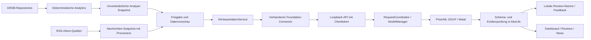
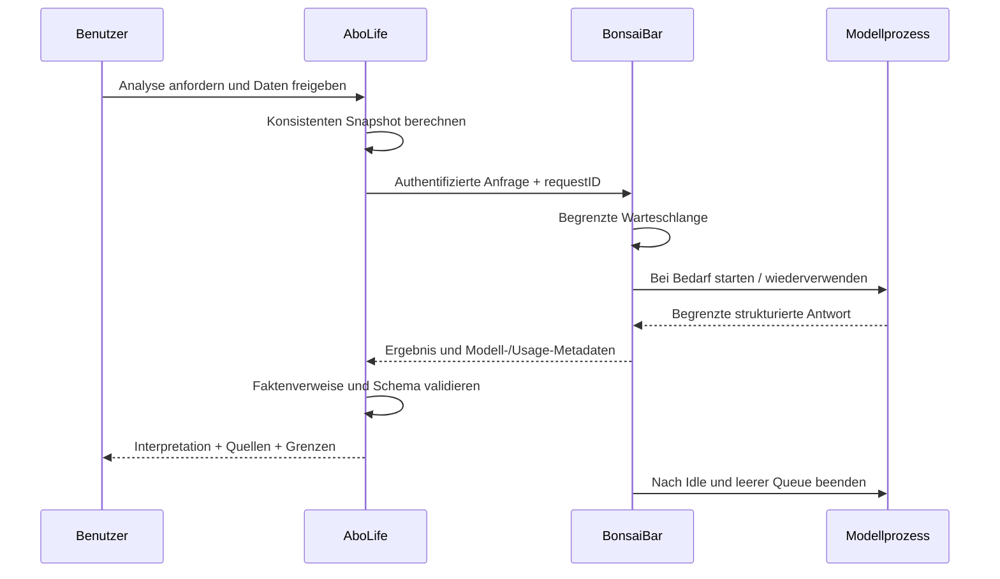

# BonsaiBar × AboLife – Analytics, Reviews und Nachrichten

**Technischer Plan, 5. November 2026. Keine Implementierungsfreigabe für die hier beschriebenen Erweiterungen.**

## 1. Verifizierter Iststand

AboLife 0.4.1 speichert Fachinformationen in GRDB/SQLite. Finanzen, Gewicht, Gewohnheiten, Training, Wochenreviews und ein RSS-/Atom-Reader existieren. Historische Ernährungstabellen sind keine aktive Funktion. Kalender/Lernplanung existieren, sind aber kein Schwerpunkt und keine neue KI-Optimierungsfunktion dieses Plans.

Im vorgefundenen Arbeitsbaum existiert bereits `Features/AI`: Connector, Keychain-Zugang, Scopefilter, Chat-/Analysehistorie und bestätigte typisierte Aktionen. Das ist **vorbestehende Arbeit**. Der aktuelle Auftrag verändert weder Inferenzprotokoll noch Grants, Systemprompts oder ausführbare KI-Aktionen. Dieser Plan beschreibt die nächste, vorrangig lesende Analytics-/Review-Schicht. Vorhandene Chatverläufe und Action-Receipts bleiben erhalten.

Das Nachbarprojekt `../BonsaiBar` ist tatsächlich lesbar. Geprüft wurden Package.swift, API.md, ARCHITECTURE.md, TESTING.md sowie ModelManager, RequestCoordinator, LocalAPIServer, HTTPMessage, APIClients und der Foundation-Connector. Es dokumentiert BonsaiBar **0.6**, macOS 14+, Swift 6.2. Das lokale Repository hat keinen auflösbaren HEAD; statt einer erfundenen Revision gilt der untersuchte Dateistand vom 5.11.2026. Vor Umsetzung Schnittstellen erneut gegen dessen Dateien prüfen.

Reale Bausteine:

- `LocalAPIServer` bindet an **127.0.0.1**, voreingestellt Port **41827**, API standardmäßig aus.
- Benannter Client, eigener zufälliger 32-Byte-Schlüssel, gehashte Registrierung, einmaliger lokaler Export und Widerruf. AboLife speichert das Geheimnis im Schlüsselbund.
- Authentifizierte `/v1/status`, `/v1/models`, `/v1/model/start`, `/v1/chat/completions`, `/v1/requests/cancel`.
- Host-/Originprüfung, getrennte interne Backendzugänge, keine Browser-CORS-Freigabe. Backendport ist keine öffentliche Integrationsschnittstelle.
- Gemeinsamer ModelManager/RequestCoordinator für Chat und API: FIFO, maximal acht Anfragen gesamt, zwei je Client, ein aktiver Generierungsslot; Wartende verhindern Idle-Unload.
- GGUF/Metal über den geprüften PrismML-llama-server und einen eigenen Prozesswächter. Kein MLX-Pfad im aktiven Katalog.
- Status-/Modellabfragen laden kein Modell. Autostart auf konkrete Anfrage; Idle-Unload, Druck-/Sleep-Behandlung und Request-Abbruch sind vorhanden. Standard-Idle: **15 Minuten**, auswählbar 0/5/10/15/30/60. Ein 5-Minuten-Test ist kein anderer Default.

## 2. Ziel und bewusste Grenzen

AboLife berechnet alle Zahlen. BonsaiBar erklärt belegte Veränderungen und formuliert prüfbare Interpretationen. Keine SQL-/Shell-Werkzeuge, keine direkten Datenbankzugriffe durch das Modell, kein automatisches Umbuchen, keine automatische Lernzeitoptimierung und keine Stundenplanvorschläge.

Die native App bleibt vollständig ohne BonsaiBar nutzbar. Eine nicht konfigurierte/abgeschaltete KI zeigt keine leeren Phantomkarten. Der bestehende Tagesstand, seine Budgetlogik und alle Eingaben funktionieren unverändert.

## 3. Architekturentscheidung

| Option | Aufwand / Wartung | Sicherheit / Ressourcen | Web-Perspektive | Entscheidung |
|---|---|---|---|---|
| Bestehende authentifizierte lokale HTTP-API | Geringster Zusatzaufwand, vorhandener Connector/SSE/Abbruch | Loopback + Clienttoken; genau ein verwalteter Modellprozess | Vertrag später hinter gesondertem Gateway nutzbar | **Zieltransport** |
| XPC / Launch-on-demand-Service | Neue Targets, Signing, Audit-Token-/Versionierungsarbeit | Starke lokale Identitätskontrolle; gute Prozessintegration | Kein direkter Webtransport | Später prüfen, falls unvermeidbare lokale Auth-Anforderungen entstehen |
| Separater gemeinsamer KI-Daemon | Neue Installation, Updates und zusätzliche Lebenszyklusverantwortung | Kann zentralisieren, dupliziert aktuell vorhandenen ModelManager | Gateway möglich | Jetzt kein belegter Vorteil |
| Modell direkt in AboLife | Kopplung an Runtime/Modell, doppeltes Packaging | Doppelte RAM-/GPU-Nutzung möglich | Wieder ein eigener Backendpfad | Ablehnen |
| Unix Domain Socket | Neuer Server-/Clienttransport, Berechtigungen/Portabilität | Dateirechte statt TCP, lokale Grenze | Zusätzliches Gateway nötig | Für spätere Härtung bewerten, kein sofortiger Transportwechsel |

Über dem vorhandenen HTTP-Connector entsteht künftig eine kleine **AIInterpretationService**-Grenze. Sie benötigt keinen neuen universellen Agentenbaukasten. Ein Fake-Interpreter testet denselben Vertrag ohne Modell. Kein Import des gesamten BonsaiCore in AboLife und kein gemeinsamer Datenbankordner.



## 4. Deterministische Analyse und Belegvertrag

Ein `AnalyticsSnapshotBuilder` liest benötigte Records in **einem konsistenten GRDB-Lesevorgang**. Er bildet ein begrenztes, unveränderliches Wertobjekt. Kein Nachladen weiterer Kategorien nach Zustimmung. Jede Auswertung enthält:

- Snapshot-ID und Vertrag-/Berechnungsversion.
- Erstellungszeit, Zeitzone und ausdrückliches halboffenes Bezugsintervall `[start, endExclusive)`.
- Datenrevision/Fingerprint nur der freigegebenen relevanten Primärdaten.
- Datenabdeckung: Eintragszahl, beobachtete Tage, fehlende Vergleichsmonate, verwendete Währung, ausgeschlossene Kategorien.
- Berechnete Kennzahlen mit stabilen `factID`s, Einheit, Zeitraum, Definition und Datenqualität.
- Vergleichsmethode: voller Monat gegen vollen Monat oder gleicher verstrichener Zeitraum. Teilmonat nie still gegen kompletten Vormonat als gleichwertig darstellen.
- Prognosen separat mit Annahmen und Modellregel; keine „sichere zukünftige Ausgabe“.

Beispiel eines künftigen reinen Datenvertrags, **kein neuer Endpoint**:

```json
{
  "schemaVersion": 1,
  "snapshotID": "fixture-snapshot-001",
  "calculationVersion": "finance-1",
  "period": {
    "start": "2026-10-01T00:00:00+02:00",
    "endExclusive": "2026-11-01T00:00:00+01:00",
    "timeZone": "Europe/Berlin"
  },
  "coverage": {"entryCount": 24, "currency": "EUR", "missingPeriods": []},
  "facts": [
    {"id": "expense.total", "valueMinor": 68400, "unit": "EUR_minor", "kind": "observed"},
    {"id": "expense.previous", "valueMinor": 60000, "unit": "EUR_minor", "kind": "observed"},
    {"id": "expense.delta", "valueMinor": 8400, "unit": "EUR_minor", "kind": "derived"},
    {"id": "expense.change", "valueBasisPoints": 1400, "unit": "percent_basis_points", "kind": "derived"}
  ]
}
```

Cent-/Basispunktdarstellung vermeidet freie Modellarithmetik. Die bestehende App verwendet Double; vor Umsetzung müssen Rundung, Eingabepräzision und Centkonvertierung mit den bestehenden Finanztests abgeglichen werden. **Kein stiller Wechsel der Berechnungsbasis oder des gespeicherten Schemas.** Prozentänderung bei Vorwert 0 ist `null` mit Grund, niemals Infinity. Verschiedene Währungen werden ohne Wechselkursquelle nicht addiert. Freitextnotizen/Titel bleiben standardmäßig draußen.

Geplante Fakten: Einnahmen/Ausgaben/Saldo, Kategorieanteile und absolute Änderungen, Budgetabweichungen, Vergleichszeiträume, wiederkehrende ähnliche Ausgaben als deterministische Kandidaten, Sparquote nur mit positiven Einnahmen. Gewohnheiten/Training/Gewicht nur bei vorhandenen Records; Lücken, geänderte Ziele und abgeleitetes „Trainieren“ aus Workouts berücksichtigen. Keine Gesundheitsdiagnosen oder vermeintlichen Trainingsrekorde aus Seedwerten.

Deterministische Smart Insights zuerst: auffällige Kategorieänderung beispielsweise erst ab Mindestbetrag, Mindestbasis und hinreichender Eintragszahl. Schwellen als Produktregel dokumentieren und testen, nicht als statistische Signifikanz verkaufen. Ein robustes statistisches Verfahren erst einsetzen, wenn die Datenmenge es trägt.

## 5. Modellantwort und Validierung

Die Modellantwort enthält begrenzte Struktur statt eines frei ausführbaren Plans:

```json
{
  "snapshotID": "fixture-snapshot-001",
  "insights": [{
    "id": "insight-1",
    "title": "Höhere Monatsausgaben",
    "evidenceIDs": ["expense.total", "expense.previous", "expense.delta"],
    "interpretation": "Prüfe, welche Kategorien die Veränderung tragen.",
    "suggestion": "Öffne den Kategorievergleich, bevor du dein Budget anpasst.",
    "limitations": ["Aus den Gesamtsummen lässt sich keine Ursache ableiten."]
  }]
}
```

Zahlen in der UI kommen **aus referenzierten Fakten**, nicht aus Modellprosa. Für die erste Version darf das Modell in Interpretations-/Empfehlungstexten keine neuen numerischen Finanzbehauptungen einführen. Ein erfolgreicher JSON-Decode ist keine Belegprüfung: Snapshot-ID, bekannte factIDs, erlaubte Quell-IDs, Längen/Anzahl, Zahlen-/Datumsbehauptungen und unzulässige Aktionsfelder werden separat validiert. Nicht belegbare Antworten bleiben unvollständig/abgelehnt und werden nicht als geprüfter Insight gespeichert. Die ursprünglichen deterministischen Werte bleiben sichtbar.

Vorschlag für eine spätere Swift-Grenze:

```swift
protocol AIInterpretationService: Sendable {
    func interpret(_ request: InterpretationRequest) async throws -> InterpretationResult
    func cancel(requestID: UUID) async
}
```

`InterpretationRequest` ist ein Sendable-Wert aus freigegebenem Snapshot und Zweck, ohne ModelContext/Repository-/DB-Handles. `InterpretationResult` enthält validierte Verweise und Status, keine Werkzeuge. Erst nach Freigabe echte Typen/Implementierung hinzufügen.

Vorhandener Transport: `POST /v1/chat/completions`, `X-Request-ID`, Bearer-Token, Thinking **aus**, begrenztes JSON-Schema. BonsaiBar begrenzt derzeit Schema auf 8 KiB/acht Ebenen/16 Eigenschaften je Objekt und Arrays auf höchstens 32 Elemente. Entwurf: höchstens fünf Insights mit je fünf Belegen; Payloadziel <16 KiB, harte Clientgrenze unter der tatsächlichen 64.000-UTF-8-Byte-Gesamtgrenze; Output anfangs höchstens 1.024 Tokens. Endgültige Tokenprüfung erfolgt gegen das echte Modelltemplate, nicht über die falsche Faustformel „Zeichen/4 garantiert passend“.

## 6. Freigabe, Datenschutz und lokale Sicherheit

1. KI global optional; neue Datenkategorien standardmäßig aus.
2. Zweck wählen: Finanzinterpretation, persönliches Review oder Newsbriefing.
3. Benötigte Kategorien und Zeiträume anzeigen; ausdrückliche Auswahl. Gewicht/Gewohnheiten sind sensible, getrennte Grants.
4. Snapshot erst nach Freigabe bilden. Vorschau zeigt **die tatsächlich gesendeten Felder**, Datenmenge und Empfänger „BonsaiBar auf diesem Mac“.
5. Nur diese unveränderliche Vorschau senden; bei geänderten Daten neue Zustimmung/Vorschau, keine stille Kontextausweitung.
6. Grants widerrufbar. Laufende Anfrage abbrechen, Gesprächskontext nicht mit früher freigegebenen Daten weiterführen.

Keine Finanz-, Review- oder Gesundheitstexte in Logs. Schlüsselbund für Clienttoken; private Dateien/SQLite-Verzeichnis mit geeigneten Dateirechten. FileVault ist eine Systemeigenschaft und keine von der App garantierte Datenbankverschlüsselung. Review-Historie und Snapshots verlassen den Mac nicht automatisch. Bestehende `SharedDocument.tableNames`-Allowlist enthält neue AI-Tabellen ausdrücklich nicht. Backups werden hinsichtlich dieser lokalen Inhalte dokumentiert, nicht ungefragt synchronisiert.

Loopback und Token schützen nicht vor allen Prozessen desselben kompromittierten Benutzerkontos. Keine CORS-Freigabe oder Weiterleitung des lokalen Ports. Verbindungsimport prüft Loopbackziel, Schema und Tokenformat. Redirects dürfen den Bearer-Token nicht an einen anderen Host/Port schicken; dies vor Implementierung separat gegen den bestehenden Connector testen. XPC mit Code-Signing-/Audit-Token-Prüfung bleibt eine mögliche spätere Härtung, falls dieses Bedrohungsmodell verlangt wird.

Löschung: einzelne Analyse oder kompletter AI-Verlauf mit verständlicher Bestätigung, zugehörige Snapshots/Feedback per transaktionaler Beziehung entfernen. Fachliche Einträge und manuelle Wochenreviews werden dabei **nicht** gelöscht. SQLite-Dateilöschung garantiert auf SSDs keine forensische Vernichtung; Sicherungskopien haben eine eigene Aufbewahrung. Keine falsche „sofort sicher vernichtet“-Aussage.

## 7. Review-Historie und Feedback

Vorhandene `weekly_reviews` sind manuell und pro Woche eindeutig. Sie bleiben erhalten. KI-Reviews werden nicht darübergeschrieben, sondern versioniert daneben gespeichert. Vorgeschlagene **zukünftige**, additive Migration erst nach Zustimmung:

| Tabelle | Wesentliche Felder |
|---|---|
| `analysis_snapshots` | id, schema/calculation version, period start/end, timezone, createdAt, scope manifest, fingerprint, coverage, minimiertes Snapshot-JSON |
| `ai_reviews` | id, snapshotID FK, reviewKind, modelID, prompt/schema version, generatedAt, validated result, status, supersedesReviewID? |
| `ai_insight_feedback` | id, reviewID, insightID, helpful/irrelevant/incorrect, createdAt, optionale lokale Anmerkung |

Ein Snapshot ist unveränderlich. Neue Fachbuchungen machen einen bestehenden Review historisch, nicht automatisch falsch; die UI zeigt „Datenstand vom …; seitdem geändert“. Derselbe Zeitraum kann einen neueren Review erhalten, alte Versionen bleiben nachvollziehbar. Bei wiederholtem Request/Timeout sorgt eine Anfragekennung für idempotente Ergebnisübernahme, ohne manuelle Notizen zu überschreiben.

Feedback verändert weder Fakten noch Modellgewichte. „Unzutreffend“ markiert die Aussage sichtbar und schließt sie aus künftigen Empfehlungszusammenfassungen aus; der zugrunde liegende Fakt bleibt nachprüfbar. Keine automatische Fine-Tuning-/Cloud-Pipeline. Personalisierte Reihenfolge erst nach genug ausdrücklichem Feedback und mit Rücksetzoption. Kein Feedback als Wahrheit über Finanzzahlen behandeln.

Reviewqualität: jeder Insight hat Belege und Zeitraum; Zahlen stimmen exakt mit Fakten überein; Interpretationen sind als solche erkennbar; mindestens eine relevante Veränderung oder ehrlicher Wenig-Daten-Hinweis; Empfehlungen nennen eine nachvollziehbare Handlung, keine erfundene Ursache. Automatisches Prüfraster plus menschliche Abnahme mit fiktiven Datensätzen.

## 8. Nachrichten

Der aktuelle Reader hat Titel, URL, Quelle, Kategorie und optional Veröffentlichungsdatum. **Damit sind nur Schlagzeilenbriefings belegbar, keine vollständigen Artikelzusammenfassungen.** Die erste Version bezeichnet sie ausdrücklich so. Fehlt ein Datum, wird es als unbekannt angezeigt, niemals aus Abrufzeit erfunden.

Für spätere Artikelzusammenfassungen ist ein zusätzlicher, kontrollierter Contentpfad nötig: zulässiger Feed-Volltext oder vom Nutzer ausdrücklich ausgewählter Artikeltext; Quellennutzungsregeln, Paywalls und Inhaltsrechte beachten. Kein automatisches Umgehen von Schranken. Vor Versand feste `articleID`, Original-URL, Quelle, publiziert/abgerufen, Textumfang, truncation flag und Inhaltsfingerprint.

Stufen:

- AboLife filtert erlaubte Quellen, Interessen und Ausschlusswörter; sortiert zuerst deterministisch nach Zeit/Topic.
- Doppelte URLs/Titel deterministisch erkennen; semantische Gruppierung nur als Modellvorschlag, mit allen zugehörigen Quellverweisen.
- Briefingabsatz muss mindestens eine **gelieferte** articleID referenzieren. Nicht gelieferte URLs/IDs oder behauptete Ereignisse ohne Beleg ablehnen.
- Relevanzpräferenzen lokal speichern; Finanzdaten nie für News-Personalisierung mitgeben, sofern nicht separat und sinnvoll freigegeben.
- Originalartikel bleibt mit Quelle und Datum erreichbar. Fehlerhafte/gekürzte Zusammenfassung ersetzt nicht die Meldung.

RSS-Texte sind **unvertrauenswürdige Eingaben**, keine Systemanweisungen. Rollen trennen, Größen begrenzen, keine URL-/Tool-Ausführung aufgrund von Artikeltext. Prompt-Injection-Fixtures gehören zur Abnahme.

## 9. UI-Konzept im bestehenden Design

Kein generisches Chatdashboard und keine neue Sidebarstruktur. Dieselben matten AboLifeCards, SF-Typografie, dezenten Akzentfarben und Motiontokens.

- **AI Insights Card:** nach ausdrücklicher Aktivierung unter den primären Dashboarddaten; maximal eine Hauptaussage, Bezug „Oktober · 24 Buchungen“, Faktchips aus AboLife. Eine klare Detailaktion. Ausgeblendet, solange keine fertige validierte Analyse vorhanden ist; kein funktionsloser „Demnächst“-Button.
- **Review Assistant:** im Wochenreview als optionale zweite Ebene neben dem manuellen Rückblick. Zeitraum + Datenstand zuerst, dann Fakten/Interpretation/Handlung getrennt. Eigene Notizen bleiben editierbar und werden nie automatisch ersetzt.
- **Smart Suggestions:** konkrete, lesende Aktionen wie „Kategorievergleich öffnen“; keine automatische Änderung von Budget oder Gewohnheiten. Spätere Schreibaktionen nur in einem getrennt freigegebenen Konzept mit typisierter Vorschau.
- **AI News Briefing:** eigener Abschnitt über den tatsächlichen Artikeln mit Quellen pro Absatz und sichtbarer Kennzeichnung „Schlagzeilenbriefing“. Originalkarten bleiben erreichbar.
- **Historie:** Liste nach Zeitraum, Erstellungszeit und Datenstand; zwei Reviews vergleichen, Empfehlungen erneut ansehen, hilfreiche/unpassende/unzutreffende Insights markieren. Keine erfundenen Revieweinträge zur Füllung.

Zustände: deaktiviert, nicht verbunden, bereit, wartend, Modell lädt, analysiert, prüft, vollständig, unvollständig, veraltet, abgebrochen, Fehler. Ladehinweis erklärt Modellstart ohne vorgetäuschte Prozentanzeige. Abbruch sofort erreichbar. Bei Ausfall „BonsaiBar öffnen / erneut versuchen“; alle Fachbereiche bleiben bedienbar. Reduce Motion deaktiviert Übergänge; keine pulsierenden Dauerindikatoren.

## 10. Ressourcen und Performance

AboLife fragt Status ohne Modellstart ab. Nur explizit ausgelöste Analysen oder separat aktivierte geplante Reviews erzeugen Arbeit. In der ersten Version keine Hintergrundanalysen bei jedem Tastendruck, Appstart oder Sync.



BonsaiBar allein besitzt den Modell-Lebenszyklus. AboLife beendet keinen fremden Prozess und lädt kein zweites Modell. Abbruch verwendet die eigene requestID; Transportabbruch darf keine Warteschlange/Generierung verwaisen lassen. Sleep/Wake und Speicherdruck müssen einen sichtbaren wiederholbaren Zustand liefern; keine automatische Doppelanfrage nach Wake.

Bereits dokumentierte **fremde Messungen**, hier nicht erneut ausgeführt: BonsaiBar TESTING.md nennt für 4B etwa 0,61 s Start, 59,12 Tokens/s und 1,60 GB resident; für 27B in einem API-Lauf 7,93 GB resident sowie frühere Starts 2,48–17,40 s. Resident RAM ist weder vollständige Unified-Memory- noch garantierte Peakmessung. Modellgrößen und diese Einzelmessungen werden nicht als Anforderungs-SLA verkauft.

Abnahmebudgets als **Ziele**: UI-Reaktion/Abbruchanzeige <100 ms, Snapshot bei typischer Historie P95 <100 ms, Feedback auf Modellstart sofort, erste strukturierte Ergebnisse warm <5 s/4B bzw. <20 s/27B bei begrenztem Output, Kaltstart mit tatsächlichem Zustand statt falscher Fortschrittszahl. Diese KI-Latenzziele sind erst mit repräsentativen Prompts auf Zielhardware zu bestätigen. Ein 4B-Modell darf schneller, aber semantisch unzureichend sein; Auswahl nach überprüfter Insightqualität.

Ergebniscache nur für denselben Snapshotfingerprint, Zweck, Grants, Modell und Prompt-/Rechnungsversion. Kein Cache für rohe unterschiedliche Daten. Widerruf/Löschung invalidieren Ergebnisse. Geldwerte nie aus einem veralteten Cache als aktuell darstellen. Review-Historie ist ein historisches Artefakt und kein Cache.

## 11. Web/Homelab später

Der lokale BonsaiBar-Port bleibt geschlossen für LAN und Browser. Eine Webapp benötigt einen **eigenen** authentifizierten Server-/Gatewayvertrag: TLS, Geräteidentität, origin-/CSRF-Schutz, kurze Sessions, Quoten, Audit ohne Prompts, explizite Kategoriegrants und Verschlüsselung/Backups/Revocation. Ein im Browser eingebetteter BonsaiBar-Clienttoken ist keine Lösung.

Bevorzugt erstellt AboLife lokal einen freigegebenen Snapshot. Ein optionaler Homelab-Worker kann nach separatem Auftrag denselben Interpretervertrag implementieren. Übertragung privater Daten auf einen anderen Rechner braucht eine neue klare Freigabe; „lokal auf diesem Mac“ darf dann nicht behauptet werden. Kein öffentlicher Port als Vorbereitung.

## 12. Umsetzung nach Abstimmung

| Schritt | Konkretes Ergebnis | Abnahme |
|---|---|---|
| 1 Fachvertrag | Versionierte Fakten-/Coverage-/Zeitraumtypen und Rundungsvorschrift | Referenzfixtures: Nullbasis, Teilmonate, DST, fehlende Tage, verschiedene Währungen, aktuelle versus historische Ziele |
| 2 Deterministische Analytics | Konsistente Snapshot-Erzeugung, Vergleichs-/Anomaliekandidaten | Bestehende Summen-/Budgettests plus Äquivalenz zu Repositories und Performancebudget |
| 3 Interpretation ohne Persistenz | AIInterpretationService auf bestehendem Connector, Fake und Validator | Ungültiges JSON, neue Zahlen, unbekannte Belege, fremde IDs, Prompt-Injection, Kontextlimit, Abbruch/Rate/Timeout |
| 4 Lokale Historie | Additive Migration, vorab konsistente Sicherung, Versionen/Feedback/Löschung | Upgrade aus echter voriger Schemafixture, rollback bei Fehler, Backup/Restore, kein Syncexport |
| 5 UI | Ein echter Dashboard-Insight und Reviewdetails, native Fehlerzustände | Hell/Dunkel, Reduce Motion, VoiceOver, schmale/kurze Fenster, Tastatur, Modell offline |
| 6 Nachrichten | Zuerst belegtes Schlagzeilenbriefing; Volltext separat | Quellen-/Datumstreue, leere Texte, doppelte Meldungen, veraltete Quellen, erfundene Verweise abgewiesen |
| 7 Ressourcenabnahme | Ein Modell, begrenzte Queue, Idle-Unload, Sleep/Wake | 4B/27B auf Zielhardware, warmer/kalter Start, RAM/Metal, konkurrierender BonsaiBar-Chat, Widerruf |

Vor Umsetzung abzustimmen: zunächst nur lesende Finanz-/Wochenreview-Insights; gewünschte Opt-in-Kategorien; Aufbewahrung der Snapshots; Schlagzeilenbriefing versus ausdrücklich beauftragter Volltextzugriff; Zielhardware/Modell; optionale automatische Review-Zeitpunkte. Diese Entscheidungen blockieren **nicht** die hier beauftragten UI-/Qualitätsverbesserungen, sondern begrenzen allein die nächste KI-Implementierung.

Lokale Referenzen: [BonsaiBar API](../../BonsaiBar/API.md), [Architektur](../../BonsaiBar/ARCHITECTURE.md), [Messstand](../../BonsaiBar/TESTING.md), [bestehende AboLife-AI-Integration](AI_INTEGRATION.md). Modell-/Runtimeangaben beziehen sich auf den überprüften lokalen Stand, nicht auf eine behauptete zukünftige Engineversion.
