# Native Design-Galerie

Diese zwölf Bilder zeigen echte SwiftUI-Dashboard-Views mit fiktiven Vorschauwerten: drei Designs, zwei Darstellungen und zwei Inhaltsbreiten. Export durch `DesignRenderingTests` mit `ImageRenderer`, 2× Auflösung. Es sind **Dashboard-Ausschnitte ohne Fensterrahmen, Navigation und KI-Dialog**, keine vollständigen Fensteraufnahmen und keine erfundenen Mockups.

Die laufende isolierte Demo wurde zusätzlich manuell geprüft: Spatial, Bento, Fieldnotes, Widgetwechsel und vorhandener KI-Dialog. Die neue automatisierte Fensteraufnahme-Prüfung ist vorbereitet, konnte in dieser Umgebung jedoch nicht ausgeführt werden. Das macOS-Bildschirmfoto-Systemwerkzeug ließ sich ebenfalls nicht starten. Frühere Fensteraufnahmen stehen getrennt unter [Archiv 0.4](archive/screenshots-0.4/README.md).

## Spatial

| Hell · 1100 pt | Dunkel · 1100 pt |
|---|---|
| 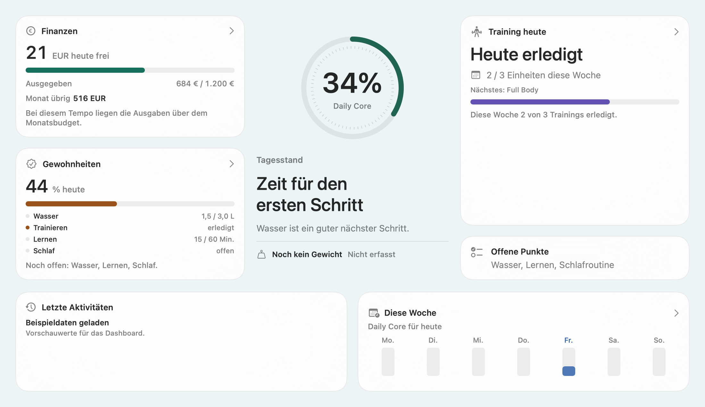 | 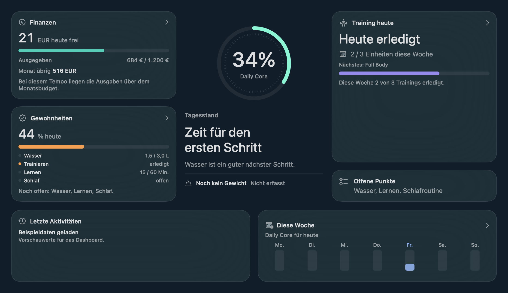 |

<details>
<summary>Schmale Ansicht · 660 pt</summary>

| Hell | Dunkel |
|---|---|
| 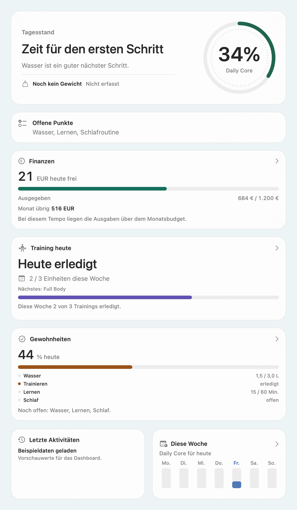 | 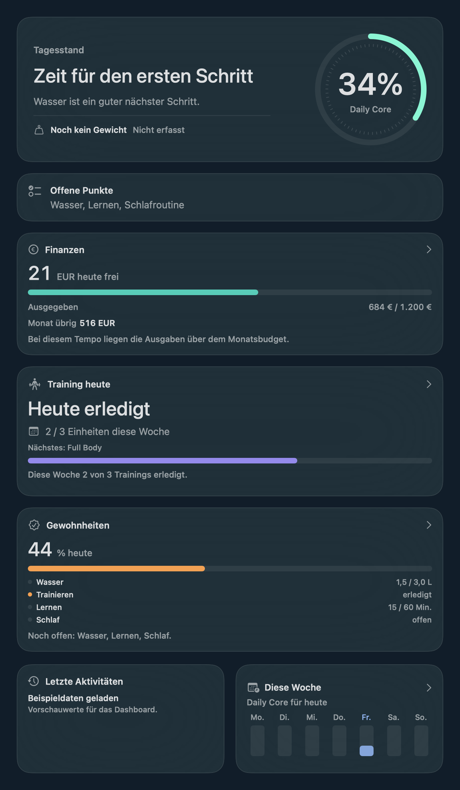 |

</details>

## Bento

| Hell · 1100 pt | Dunkel · 1100 pt |
|---|---|
| 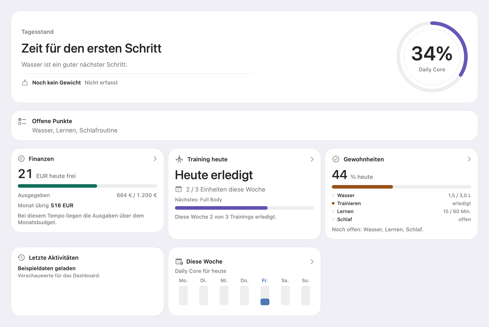 | 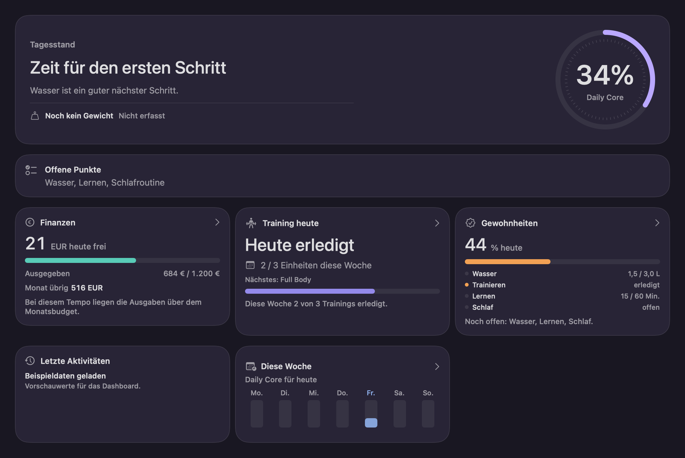 |

<details>
<summary>Schmale Ansicht · 660 pt</summary>

| Hell | Dunkel |
|---|---|
| 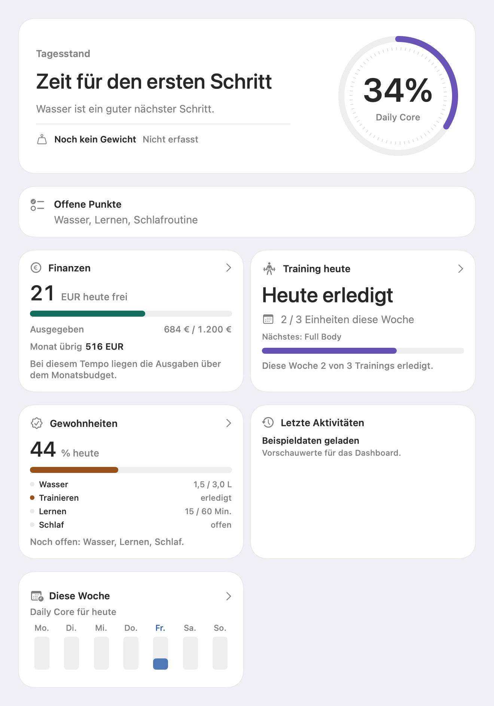 | 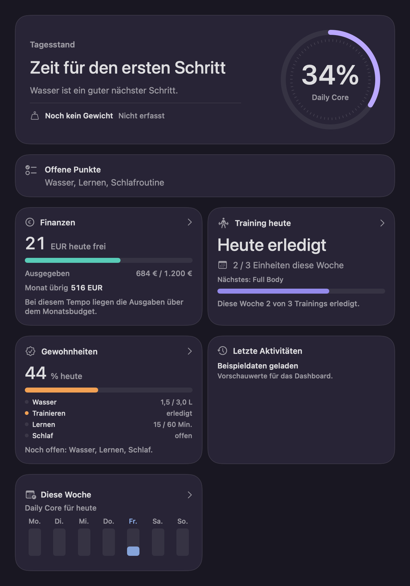 |

</details>

## Fieldnotes

| Hell · 1100 pt | Dunkel · 1100 pt |
|---|---|
| 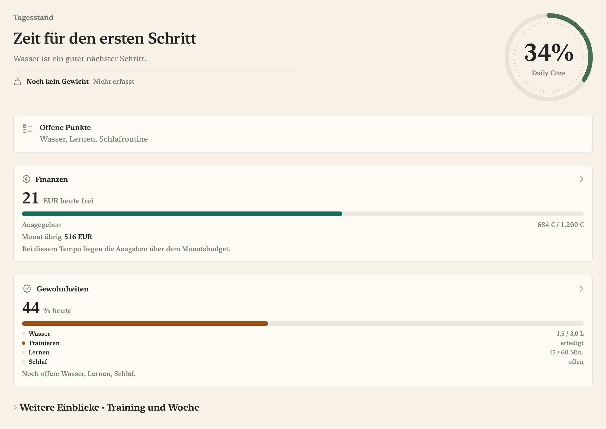 | 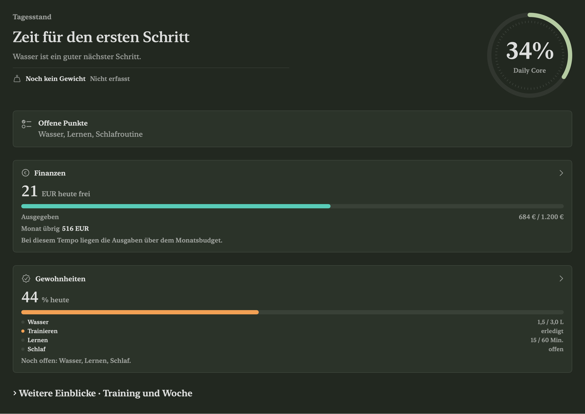 |

<details>
<summary>Schmale Ansicht · 660 pt</summary>

| Hell | Dunkel |
|---|---|
| 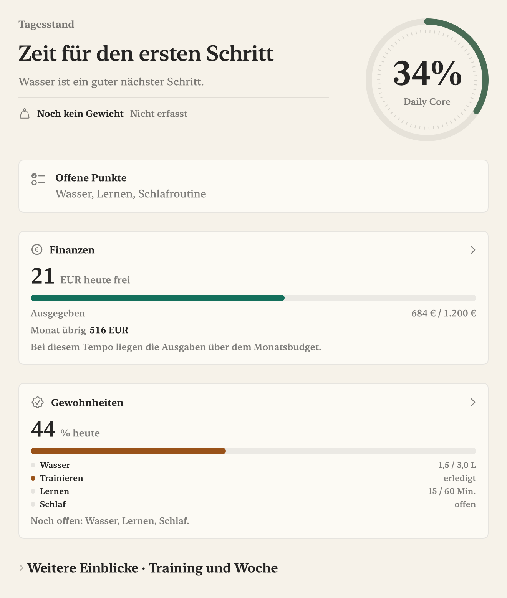 | 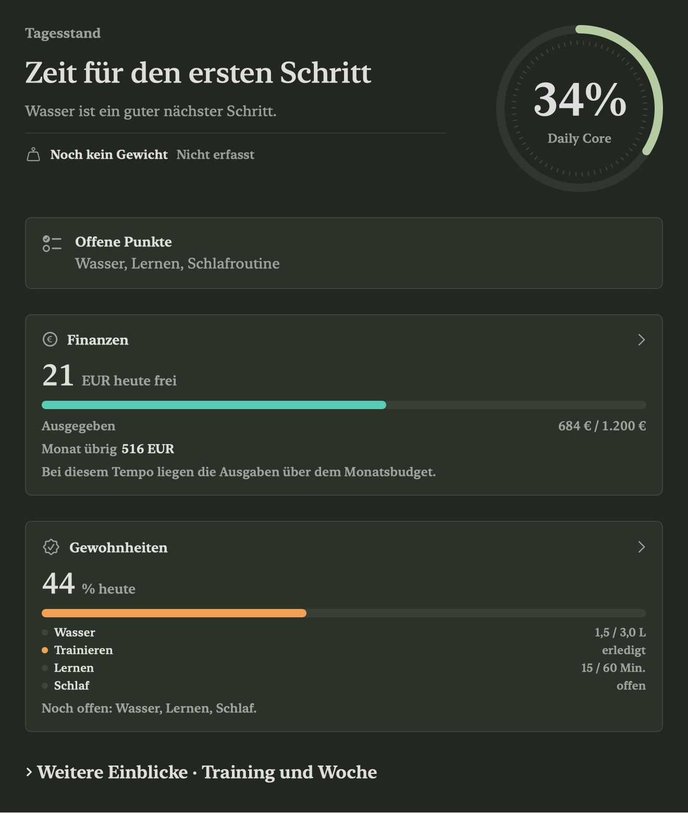 |

</details>

## Reproduzieren

```sh
ABOLIFE_DESIGN_RENDER_DIR="$PWD/work/design-captures" scripts/check-native.sh
```

Für tatsächliche Fensteraufnahmen ist `AboLifeUITests.testThreeDesignsAndAssistantScreenshots` vorbereitet. Der Runner kann mit `ABOLIFE_UI_SCREENSHOTS` einen separaten Ausgabeordner erhalten. Er startet ausschließlich `com.private.AboLife.demo` mit `ABOLIFE_DEMO=1`. Niemals Bilder der persönlichen Haupt-App veröffentlichen.
